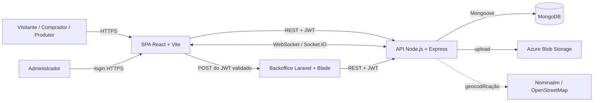
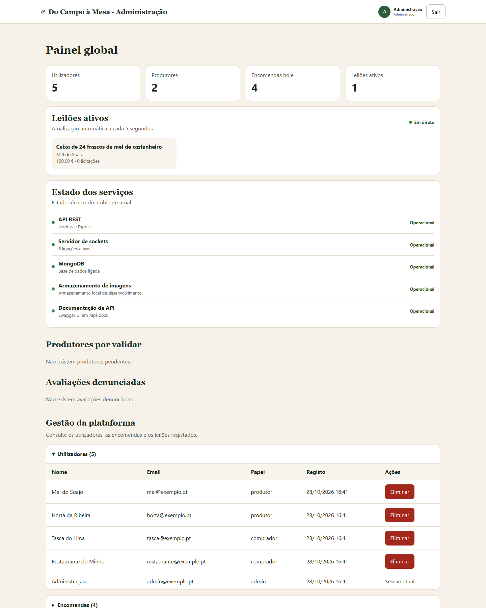
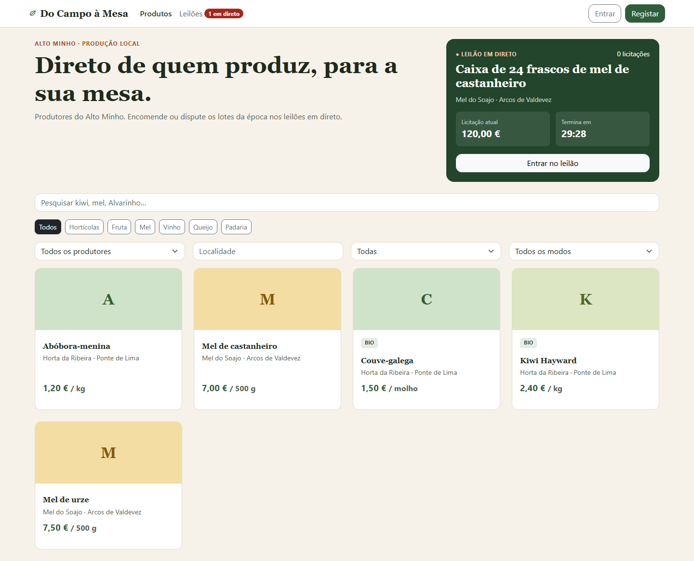
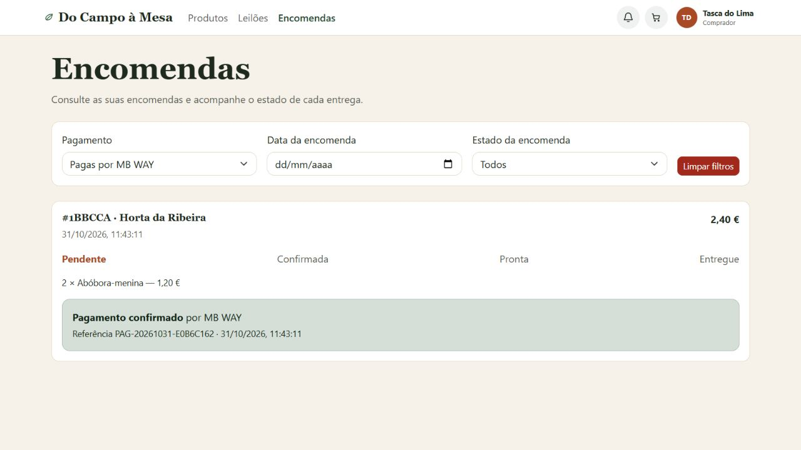
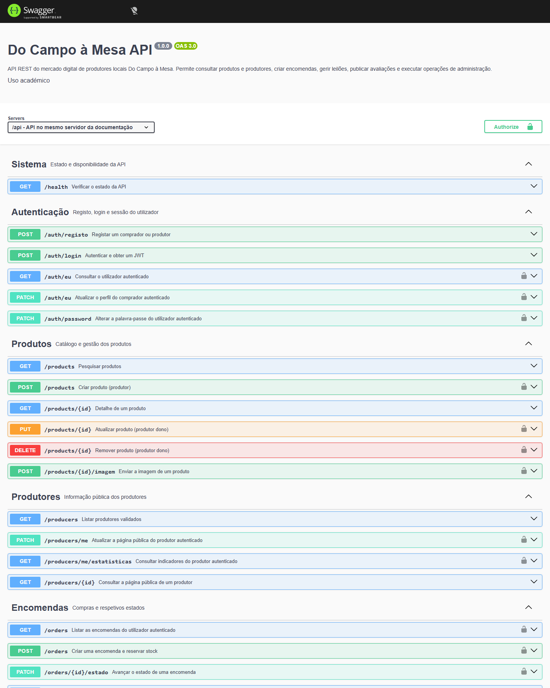
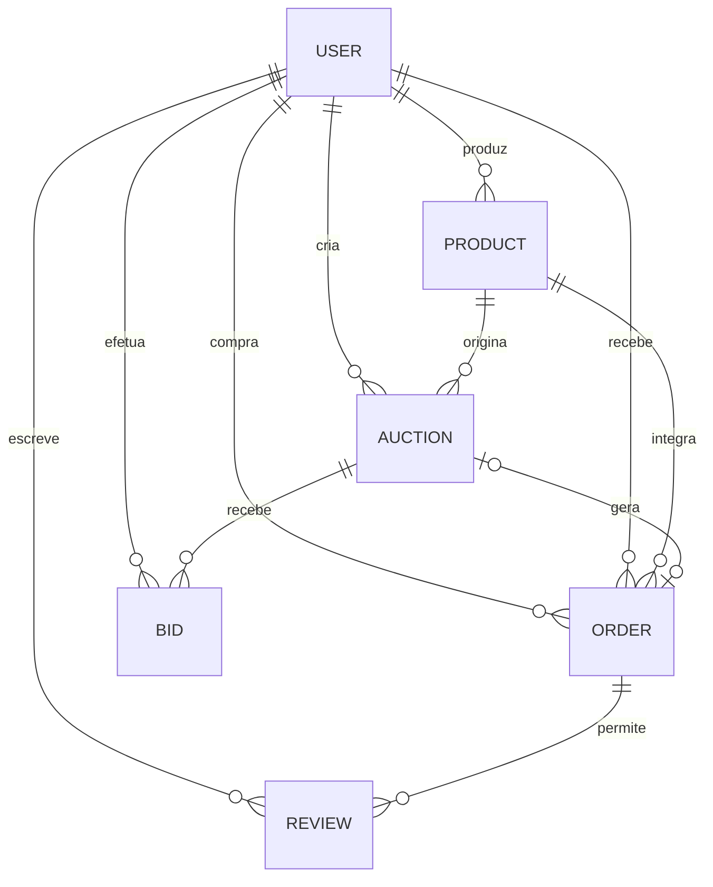
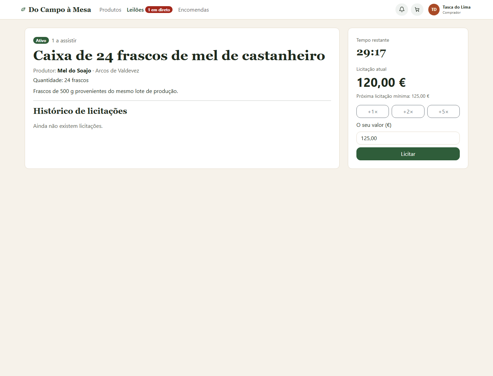

# Relatório · Do Campo à Mesa

> Relatório do projeto, incluindo a validação do ambiente publicado. Limite: 20 páginas.

## 1. Introdução

O **Do Campo à Mesa** é um mercado digital que aproxima produtores locais e compradores, incluindo particulares e estabelecimentos de restauração. A aplicação permite divulgar produtos, pesquisar a oferta por diferentes critérios, efetuar encomendas e realizar leilões em tempo real. Pretende-se reduzir a distância entre produção e consumo, aumentar a visibilidade dos produtores e fornecer informação atualizada sobre stock, encomendas e licitações.

O sistema contempla quatro perfis de utilização:

- o **visitante** consulta o catálogo, os produtores e os leilões públicos;
- o **comprador** gere o carrinho, simula pagamentos, cria encomendas, acompanha estados, avalia compras e participa em leilões;
- o **produtor** gere o perfil público, produtos, fotografias, stock, encomendas e leilões;
- o **administrador** valida produtores, modera avaliações e acompanha a plataforma através de um backoffice Laravel.

O trabalho inclui uma SPA React, uma API REST em Node.js e Express, comunicação em tempo real com Socket.IO, persistência em MongoDB e um backoffice independente em Laravel e Blade. A especificação OpenAPI, os testes automáticos e a preparação para deployment em serviços cloud completam a solução.

## 2. Arquitetura

A solução encontra-se organizada em três aplicações no mesmo repositório:

- `web/`: SPA React compilada pelo Vite;
- `api/`: API Node.js/Express, servidor Socket.IO e ciclo dos leilões;
- `backoffice/`: aplicação Laravel/Blade para administração.

O frontend e o backoffice não acedem diretamente à base de dados. Ambos utilizam a mesma API, centralizando autenticação, validações e regras de negócio. A SPA acrescenta uma ligação Socket.IO à API para licitações e notificações. Esta separação permite publicar cada aplicação num serviço diferente e substituir o endereço de cada componente através de variáveis de ambiente.



*Figura 1 — Arquitetura lógica da solução e comunicação entre os seus componentes.*

No servidor, `server.js` cria um único servidor HTTP partilhado pelo Express e pelo Socket.IO. A instância do Socket.IO fica disponível às rotas através de `app.set('io', io)`, permitindo que alterações feitas por REST originem notificações em tempo real. O ciclo dos leilões abre e termina leilões periodicamente e cria a encomenda do vencedor de forma idempotente.

O serviço de imagens possui duas estratégias. Em desenvolvimento grava em `api/uploads/`; quando `STORAGE_CONN` está definida, envia os ficheiros para Azure Blob Storage e guarda apenas o URL no produto. A geocodificação dos códigos postais usa o Nominatim, com fila, limite temporal e cache em memória para reduzir pedidos externos.

O backoffice segue MVC e Blade. Os controllers utilizam `ApiAdmin`, um serviço HTTP com timeouts e envio do token JWT. Optou-se por não duplicar os modelos Mongoose em Eloquent: a API permanece a única responsável pelas regras de negócio e pelo acesso aos dados. Eloquent não é usado nesta versão, correspondendo a uma componente opcional de valorização que não foi implementada.



*Figura 2 — Painel global do backoffice Laravel, com indicadores, estado dos serviços e gestão da plataforma.*

## 3. Frontend e SPA

### 3.1 Tecnologias e organização

O frontend foi desenvolvido em **React 18** com **Vite**, **React Router**, **Bootstrap 5** e **SASS**. React foi escolhido pela composição em componentes, gestão declarativa da interface e facilidade de sincronização com dados assíncronos. O Vite fornece arranque e compilação rápidos, enquanto Bootstrap disponibiliza uma base responsiva e acessível que é personalizada pelo SASS.

O código está dividido em páginas, componentes reutilizáveis, contextos, hooks e um cliente HTTP central. Alguns exemplos são:

- `CartaoProduto`, `EstadoEncomenda`, `FormularioAvaliacao`, `Navbar` e `RotaProtegida`;
- `useApi`, `useLeilao`, `useLeiloesEmDireto`, `useContagem` e `useNotificacoes`;
- páginas de catálogo, produtor, carrinho, encomendas, leilões e áreas reservadas.

O cliente em `api/client.js` junta o URL base, serializa JSON, envia o token e transforma respostas de erro num objeto uniforme. O URL da API é definido por `VITE_API_URL`, permitindo usar endereços diferentes em desenvolvimento e produção.



*Figura 3 — Catálogo público da SPA, com pesquisa, filtros, produtos locais e destaque de um leilão.*

### 3.2 Estado global

Foram usados contextos React para o estado partilhado:

- `AuthContext` mantém o utilizador e o JWT, restaura a sessão a partir de `localStorage` e confirma o token através de `/api/auth/eu`;
- `CarrinhoContext` guarda linhas, quantidades e totais, persiste o carrinho no browser e agrupa produtos por produtor, pois cada produtor origina uma encomenda diferente;
- `SocketContext` mantém uma única ligação Socket.IO por sessão autenticada;
- `NotificacoesContext` agrega os eventos recebidos e alimenta a interface de notificações.

O estado específico de cada página permanece local. Esta opção evita introduzir uma biblioteca adicional de gestão de estado quando os contextos são suficientes para o volume da aplicação.

O checkout está dividido em confirmação da entrega e pagamento. O comprador escolhe cartão ou MB WAY; os campos visuais completam o fluxo, mas apenas o método é enviado à API. As encomendas ganhas em leilão, que não passam pelo carrinho, ficam por pagar e apresentam a mesma interface na área de encomendas. O histórico mostra estado, método, referência e data do pagamento.



*Figura 4 — Área autenticada do comprador, mostrando encomendas normais e uma encomenda criada a partir de um leilão.*

### 3.3 Routing e controlo de acesso

O React Router separa rotas públicas e rotas protegidas. `RotaProtegida` verifica a autenticação e o papel antes de renderizar as páginas de comprador, produtor ou administrador. A proteção no frontend melhora a navegação, mas não é considerada uma barreira de segurança: todos os endpoints sensíveis repetem a verificação na API.

O caminho `/admin` da SPA efetua a passagem autenticada para o backoffice Laravel, que continua a ser uma aplicação independente. Depois do login comum, um administrador é encaminhado automaticamente: a SPA envia o JWT num formulário `POST` para o Laravel, que o valida junto da API e cria a sua própria sessão. Assim, não existe um segundo login nem se coloca o token no URL. A sessão persistida é recuperada ao reabrir o browser; se um utilizador autenticado visitar `/login`, a SPA encaminha-o conforme o papel, sem voltar a mostrar o formulário. Um token expirado ou associado a outro papel é removido antes de regressar ao login único. As rotas desconhecidas mostram uma página 404 da SPA.

### 3.4 Mobile First e acessibilidade

Os estilos partem do ecrã mais pequeno e usam o mixin SASS `a-partir-de()` para acrescentar regras nos breakpoints de **768 px**, **1024 px** e **1280 px**. A grelha do catálogo, a navegação, os formulários, as tabelas e os painéis adaptam-se progressivamente ao espaço disponível.

Foram utilizados elementos semânticos, labels associados aos campos, texto alternativo nas imagens, estados de foco, uma ligação “Saltar para o conteúdo” e suporte para `prefers-reduced-motion`. O menu Bootstrap colapsa em ecrãs pequenos e as mensagens de sucesso e erro são apresentadas junto das ações correspondentes.

## 4. API REST e documentação

### 4.1 Organização e recursos

A API utiliza Node.js 20, Express e Mongoose. `app.js` configura CORS, JSON, ficheiros locais, Swagger e tratamento de erros; `server.js` acrescenta HTTP, Socket.IO, ligação ao MongoDB e o ciclo dos leilões.

Os principais recursos são:

| Recurso | Operações principais |
|---|---|
| Autenticação | registo, login, consulta e alteração do perfil, mudança de password |
| Produtores | listagem pública, perfil, edição e estatísticas |
| Produtos | pesquisa, filtros, CRUD e upload de fotografia |
| Encomendas | criação, listagem, detalhe e transição de estado |
| Leilões | criação, listagem, detalhe e histórico de licitações |
| Avaliações | criação, consulta e denúncia |
| Administração | estatísticas, validação, moderação e listagens globais |

São usados `GET`, `POST`, `PUT`, `PATCH` e `DELETE`. As respostas seguem códigos HTTP adequados:

- `200` para consultas e alterações com resposta;
- `201` e cabeçalho `Location` para criação;
- `204` para operações concluídas sem corpo;
- `400` para dados inválidos;
- `401` para autenticação ausente ou inválida;
- `403` para falta de permissão;
- `404` para recursos inexistentes ou inacessíveis;
- `409` para conflitos de estado, stock ou duplicação;
- `500` apenas para falhas internas não previstas.

O middleware de erros converte validações Mongoose, identificadores inválidos, índices únicos e erros de upload numa estrutura JSON coerente. As rotas assíncronas usam um wrapper comum para encaminhar exceções ao middleware.

### 4.2 OpenAPI e Swagger

A especificação `api/openapi.yaml` documenta os caminhos, parâmetros, corpos, respostas, schemas e autenticação Bearer. O Swagger UI é servido pela própria API em `/api-docs`, permitindo consultar e experimentar os endpoints.

- URL local: `http://localhost:3000/api-docs`
- URL pública: `https://dcm-api-fc2026.azurewebsites.net/api-docs`



*Figura 5 — Swagger UI gerado a partir da especificação OpenAPI, com os recursos e operações REST disponíveis.*

## 5. Modelo de dados

O MongoDB contém seis coleções: `users`, `products`, `orders`, `auctions`, `bids` e `reviews`. Os schemas Mongoose validam campos obrigatórios, valores permitidos e limites antes de os documentos serem gravados. O campo `passwordHash` de `users` usa `select: false`, pelo que não é devolvido nas consultas normais nem nas respostas da API.



As linhas ficam embebidas em cada encomenda porque são poucas, são sempre lidas com a encomenda e precisam de conservar uma cópia do nome, preço e unidade no momento da compra. O pagamento também é embebido, pois existe no máximo um por encomenda e é apresentado sempre com ela; guarda apenas estado, método, referência e data. Os dados próprios da exploração ficam embebidos no utilizador produtor, pois formam uma relação pequena de um para um. A licitação atual fica embebida no leilão para poder ser comparada e atualizada atomicamente.

Produtos, encomendas, leilões, licitações e avaliações referenciam utilizadores através de `ObjectId`. As licitações completas ficam na coleção `bids`, pois um leilão pode receber muitas e o documento principal não deve crescer sem limite. As avaliações ficam em `reviews` para poderem ser consultadas por produtor e moderadas de forma independente.

Foram criados índices para emails únicos, pesquisas de produtos, encomendas por comprador ou produtor, datas e estados dos leilões e controlo de avaliações duplicadas. As consultas usam `$regex` para pesquisa textual, `$in` para listas e épocas, `$gte`/`$lte` para preços e datas, `$lt`/`$gt` para o ciclo dos leilões e `$inc` para alterações atómicas de stock. Os virtuais `Product.disponivel` e `Order.total` calculam valores derivados sem os guardar.

O comando `npm run seed`, executado na pasta `api`, repõe dados coerentes de demonstração: cinco utilizadores, cinco produtos, três encomendas com pagamentos, três leilões, cinco licitações e duas avaliações. Um dos leilões é histórico e já fica associado à respetiva encomenda; as datas dos leilões restantes são calculadas relativamente ao momento da execução. O seed apaga previamente as coleções da aplicação e deve ser usado apenas em desenvolvimento ou num ambiente próprio de demonstração.

## 6. Segurança

### 6.1 Autenticação e autorização

Após o login, a API emite um JWT assinado com `JWT_SECRET`, contendo o identificador, papel e nome do utilizador. O token é enviado em `Authorization: Bearer <token>` e validado pelo middleware `auth(...papeis)`. Tokens ausentes, inválidos ou expirados recebem `401`; um papel sem autorização recebe `403`.

O produtor precisa ainda de estar aprovado por um administrador. O middleware `produtorValidado` consulta a base de dados antes de permitir a publicação de produtos ou leilões. Os sockets usam o mesmo JWT durante o handshake e entram numa sala pessoal apenas depois da validação.

No backoffice, o Laravel autentica através da API. Recebe o JWT por `POST` a partir da origem exata configurada em `SPA_URL`, consulta `/api/auth/eu` e só cria a sessão quando a API confirma o papel `admin`. O token nunca é incluído na query string. A sessão Laravel é regenerada para prevenir fixation e o token fica guardado apenas nessa sessão. A passagem proveniente da SPA possui limitação de pedidos. Não existe um formulário de login próprio no domínio técnico: `/entrar` encaminha sempre para o login único da SPA. O logout invalida a sessão Laravel, regenera o token CSRF e passa por uma rota pública da SPA que remove também o JWT do `localStorage` antes de regressar ao catálogo.

### 6.2 Passwords, dados e pedidos

As passwords são transformadas com bcrypt e custo 12 antes de serem guardadas. O hash não é selecionado por omissão e nunca integra os dados públicos do utilizador. A API valida emails, papéis, estados, preços, quantidades, datas, classificações e propriedade dos recursos. Preços e produtores das encomendas são lidos da base de dados em vez de serem aceites do browser.

O fluxo não integra um gateway de pagamento externo. Números de cartão, validade, CVC e telefone não são enviados à API nem persistidos; o servidor recebe apenas o método, calcula o valor a partir da encomenda e gera a referência. Uma atualização condicional impede dois pagamentos concorrentes e o produtor não pode confirmar uma encomenda ainda por pagar.

O stock é alterado com operações condicionais e `$inc`, evitando vender uma quantidade que deixou de estar disponível. Se uma encomenda com várias linhas falhar depois de algumas reservas, a API compensa as alterações já feitas. Transições de estado usam o estado anterior como condição para detetar pedidos concorrentes.

O upload aceita apenas JPEG, PNG ou WebP e limita cada ficheiro a 5 MB. O JSON está limitado a 1 MB. As views Blade escapam conteúdo recebido da API, comportamento coberto por teste, e o React escapa valores renderizados por omissão.

### 6.3 Configuração de produção

Os segredos e URLs ficam em `.env`, excluído do Git; os ficheiros `.env.example` documentam apenas os nomes das variáveis. CORS autoriza a origem definida em `CLIENT_URL`. Em produção, o Express confia no proxy da plataforma e redireciona HTTP para HTTPS. O deployment deve definir um `JWT_SECRET` longo e aleatório, restringir o acesso ao MongoDB e nunca expor `STORAGE_CONN` no frontend.

O JWT da SPA é atualmente persistido em `localStorage`. Esta escolha simplifica a aplicação académica, mas um cookie `HttpOnly`, `Secure` e `SameSite` reduziria a exposição do token em caso de XSS e constitui uma melhoria futura.

## 7. Tempo real e consistência dos leilões

O Socket.IO usa uma sala `leilao:<id>` por leilão e uma sala pessoal `user:<id>` por utilizador. A tabela seguinte define o contrato principal de eventos:

| Direção | Evento | Dados | Quando |
|---|---|---|---|
| Cliente → servidor | `entrar` / `sair` | `leilaoId` | Abrir ou sair da sala |
| Cliente → servidor | `licitar` | `{ leilaoId, valor }` e callback | Comprador envia uma licitação |
| Servidor → socket | `estado` | `{ agora, leilao, licitacoes }` | Entrada na sala |
| Servidor → socket | `recusada` | mensagem | Operação inválida |
| Servidor → sala | `presenca` | número de sockets | Entrada ou saída |
| Servidor → sala | `nova-licitacao` | valor, comprador, data e contador | Licitação aceite |
| Servidor → sala | `aberto` / `terminado` | identificador, vencedor e valor | Início ou fim |
| Servidor → utilizador | `nova-encomenda` | identificador e total | Nova compra ao produtor |
| Servidor → utilizador | `encomenda-atualizada` | identificador e estado | Alteração pelo produtor |
| Servidor → utilizador | `pagamento-confirmado` | encomenda, método, referência e total | Pagamento aceite |
| Servidor → utilizador | `nova-avaliacao` | classificação e produto | Avaliação recebida |
| Servidor → utilizador | `leilao-ganho` / `leilao-terminado` | lote, valor e encomenda | Conclusão do leilão |
| Servidor → utilizador | `conta-validada` | aprovação | Decisão do administrador |

Cada ligação autenticada entra automaticamente na sala pessoal do utilizador. Ao abrir um leilão, o socket entra também em `leilao:<id>`. A presença corresponde ao número de sockets nessa sala, pelo que duas janelas do mesmo utilizador contam como duas presenças. Depois de uma reconexão, a SPA volta a emitir `entrar` e recupera o estado e as últimas vinte licitações.

O servidor é a fonte da verdade. A verificação do estado, data de fim e valor mínimo integra o filtro de uma única operação `Auction.findOneAndUpdate()`. A atualização da licitação atual e o incremento de `numLicitacoes` acontecem atomicamente no MongoDB. Se dois compradores enviarem o mesmo valor simultaneamente, a primeira operação altera o valor atual; quando a segunda for avaliada, a condição já não é verdadeira e é recusada. Só depois da aceitação é criado o documento `Bid` e emitido `nova-licitacao`.

A API envia a hora do servidor no evento `estado`. O cliente calcula a diferença relativamente ao relógio local e aplica-a à contagem decrescente. Um ciclo executado a cada dois segundos abre e fecha leilões com atualizações condicionadas pelo estado anterior. No final, um índice único por leilão impede a criação de duas encomendas para o mesmo vencedor.



*Figura 6 — Sala de leilão autenticada, com presença, contagem decrescente, valor mínimo e histórico atualizado por Socket.IO.*

## 8. Deployment na Cloud

O ambiente público foi criado no Azure, na região **Spain Central**, usando a subscrição Azure for Students. Os três componentes web partilham um único plano Linux B1. Esta solução mantém os processos independentes, mas evita pagar três planos de computação.

| Componente | Serviço previsto | Modelo | Estado |
|---|---|---|---|
| SPA React | Azure App Service, build Vite servido por Node.js | PaaS | publicado com HTTPS e fallback para `index.html` |
| API Node.js + Socket.IO | Azure App Service com WebSockets ativos | PaaS | publicada e validada com 63 testes E2E |
| Backoffice Laravel | Azure App Service PHP separado | PaaS | publicado e validado através do login público |
| Base de dados | MongoDB Atlas M0 | DBaaS | ligada por `MONGODB_URI` guardada em App Settings |
| Fotografias | Azure Blob Storage (`produtos`) | armazenamento gerido | recurso criado e configurado na API |
| Geocodificação | Nominatim/OpenStreetMap | serviço externo | implementado |

O frontend foi compilado com os URLs públicos da API e do backoffice em `VITE_API_URL` e `VITE_ADMIN_URL`. A API recebe `MONGODB_URI`, `JWT_SECRET`, `CLIENT_URL`, `STORAGE_CONN` e `STORAGE_CONTAINER` através de App Settings, sem guardar segredos no repositório. O backoffice usa `APP_URL`, `APP_KEY`, `API_URL` e `SPA_URL` pelo mesmo mecanismo. A origem CORS coincide com o URL público da SPA, os três App Services forçam HTTPS, o Laravel confia nos cabeçalhos do proxy Azure necessários para preservar o esquema HTTPS e os WebSockets estão ativos no serviço da API.

A intenção inicial era publicar a SPA no Azure Static Web Apps. Contudo, as regiões permitidas pela política da subscrição de estudante não coincidiam com as regiões disponíveis nesse serviço. Como alternativa, a SPA pré-compilada foi publicada num terceiro Web App dentro do mesmo plano B1, sem criar outro plano de computação. O pequeno servidor Node.js incluído no deployment serve os ficheiros de `dist/` e devolve `index.html` nas rotas internas, garantindo o funcionamento do React Router após atualizar a página.

Foi escolhido o menor plano usado no projeto que suporta a demonstração contínua dos WebSockets. O custo do plano App Service é partilhado pelos três Web Apps e fica coberto pelos créditos da subscrição de estudante durante o período de avaliação. O MongoDB usa o nível gratuito e o Blob Storage é faturado pelo reduzido volume efetivamente guardado.

| Recurso | Plano/região | Custo mensal estimado | Custo observado |
|---|---|---:|---:|
| SPA, API e backoffice | App Service Linux B1, Spain Central | cerca de 13,14 USD/mês (0,018 USD/h × 730 h) | coberto pelos créditos Azure for Students |
| MongoDB | Atlas M0 (Free) | gratuito | gratuito |
| Blob Storage | Standard LRS, Spain Central | variável, por utilização | residual para o volume académico |

O valor do plano B1 foi consultado na [Azure Retail Prices API](https://prices.azure.com/api/retail/prices) em 2 de novembro de 2026. É apenas uma estimativa mensal: o preço efetivo pode variar e o portal deve ser consultado antes da defesa. Parar os Web Apps não elimina o custo do plano; para deixar de o consumir é necessário reduzir o plano ou eliminar o grupo de recursos depois da avaliação.

URLs públicas do deployment:

- Aplicação e login: https://dcm-web-fc2026.azurewebsites.net
- API/health: https://dcm-api-fc2026.azurewebsites.net/api/health
- Swagger UI: https://dcm-api-fc2026.azurewebsites.net/api-docs
- Backoffice (endereço técnico; o acesso normal é encaminhado pela SPA): https://dcm-admin-fc2026.azurewebsites.net

Na verificação final, os cinco endereços testados — raiz da SPA, rota interna da SPA, health check, Swagger UI e login do backoffice — responderam com HTTP 200. O preflight CORS devolveu `Access-Control-Allow-Origin` apenas para o domínio público da SPA e recusou uma origem externa. Foi ainda repetido o percurso real do administrador: login na SPA, envio autenticado por `POST` e chegada direta ao painel Laravel em HTTPS, sem segundo formulário de login. O painel técnico apresentou Azure App Service, API, Socket.IO, MongoDB Atlas, Blob Storage e Swagger como operacionais. Foi também enviado um PNG de 87 020 bytes pela rota de imagem de produto; a API devolveu um URL no contentor `produtos` e o blob respondeu com HTTP 200.

## 9. Testes e validação

O teste `api/test/e2e.js` usa a API real por `fetch` e clientes `socket.io-client`, tal como a SPA. É executado com `npm test`, depois de preparar os dados com `npm run seed` e iniciar a API. Cada verificação apresenta o resultado no terminal e qualquer falha termina o processo com código diferente de zero.

O teste cobre:

- health check, login inválido, JWT e papéis;
- registo, aprovação administrativa e login de produtor;
- criação, pesquisa, filtros, propriedade e alteração de produtos;
- stock insuficiente, reserva atómica e cálculo do total da encomenda;
- checkout com cartão e MB WAY, propriedade da encomenda, bloqueio de encomendas por pagar e concorrência de pagamentos;
- isolamento de encomendas e transições de estado;
- notificação de estado por Socket.IO;
- classificações, duplicação, denúncia idempotente e moderação;
- autenticação dos sockets, entrada em salas e restrição a compradores;
- valor mínimo, difusão e persistência das licitações;
- duas licitações simultâneas de 105 €, das quais apenas uma é aceite;
- correspondência entre licitações aceites, contador do leilão e documentos `Bid`;
- associação entre leilões históricos do seed e as respetivas encomendas.

O teste cria identificadores e emails exclusivos e remove os documentos temporários no final. A execução final apresentou:

```text
63 / 63 verificações passaram.
Todos os testes passaram.
Dados temporários do teste removidos.
```

O mesmo teste foi repetido contra `https://dcm-api-fc2026.azurewebsites.net`, com `E2E_TIMEOUT_MS=30000` para acomodar a latência do plano B1, e voltou a concluir **63/63** verificações. Esta execução confirmou em produção a autenticação, os pagamentos concorrentes, as notificações Socket.IO e a aceitação atómica de apenas uma entre duas licitações simultâneas com o mesmo valor.

O backoffice contém oito testes de funcionalidade, com 23 asserções, para redirecionamento de utilizadores não autenticados, encaminhamento do endereço técnico para o login único, fim coordenado da sessão, escape de conteúdo potencialmente perigoso nas views Blade e passagem de sessão a partir da SPA. Esta última aceita um token de administrador válido, rejeita uma origem diferente da configurada e remove uma sessão cujo utilizador já não tenha papel de administrador.

### 9.1 Testes funcionais finais com os quatro perfis

Foi executada uma validação final assistida através da interface real num navegador Chromium, usando os utilizadores de demonstração do seed. Os percursos limitaram-se a autenticação, navegação e consulta, sem criar, alterar ou eliminar registos. O resultado foi o seguinte:

| Perfil | Cenários verificados | Resultado |
|---|---|---|
| Visitante | catálogo público; listagem de leilões; redirecionamento de uma rota protegida para o login | **3/3 passaram** |
| Comprador | login pela SPA; consulta das encomendas e respetivos estados; acesso ao carrinho | **3/3 passaram** |
| Produtor | login e painel do produtor; gestão de produtos; formulário de criação de leilão | **3/3 passaram** |
| Administrador | login pela SPA; encaminhamento automático sem segundo login; painel global, serviços e gestão da plataforma | **3/3 passaram** |
| **Total** | **12 cenários de interface** | **12/12 passaram** |

Esta validação confirma o encaminhamento por papel, a proteção das rotas e a integração do backoffice com a API. Como demonstração complementar, o cenário de leilão pode ser apresentado em duas janelas do browser, confirmando atualização imediata, presença, contagem decrescente e reconexão; a concorrência de duas licitações iguais já é verificada automaticamente no teste E2E.

## 10. Dificuldades e trabalho futuro

### Dificuldades resolvidas

- **Concorrência nas licitações:** a validação e atualização foram reunidas numa operação atómica do MongoDB, eliminando a janela entre leitura e escrita.
- **Consistência do stock:** as encomendas usam atualização condicionada e compensação quando uma operação intermédia falha.
- **Sincronização temporal:** a contagem decrescente usa a hora do servidor em vez de confiar exclusivamente no relógio do browser.
- **Eventos duplicados:** os hooks removem listeners na limpeza do `useEffect` e mantêm uma única ligação partilhada.
- **Conclusão idempotente:** um índice único impede mais de uma encomenda por leilão.
- **Dados históricos do seed:** o leilão já terminado passou a incluir a encomenda correspondente, evitando uma nova tentativa de reserva de stock.
- **Separação do backoffice:** o Laravel consome a API existente, evitando regras de negócio e modelos duplicados.
- **Imagens em ambientes diferentes:** um serviço comum escolhe armazenamento local ou Azure Blob através da configuração.

### Trabalho futuro

- concluir e documentar o deployment, custos e URLs públicos;
- testar Socket.IO e CORS no domínio final e impedir suspensão do serviço durante a defesa;
- reservar stock no momento da criação de leilões associados a produtos e libertá-lo quando não existirem licitações;
- utilizar Redis Adapter e afinidade de sessão caso a API passe a ter várias instâncias;
- substituir a persistência do JWT em `localStorage` por cookies seguros;
- acrescentar testes de browser para os principais percursos e verificações automáticas de acessibilidade;
- executar testes automaticamente numa pipeline CI;
- otimizar e redimensionar imagens, bem como eliminar blobs que deixem de estar associados a produtos;
- acrescentar paginação às listagens que possam crescer significativamente;
- reforçar observabilidade com logs estruturados, métricas e alertas.

## 11. Declaração de uso de ferramentas e IA

Foram utilizadas as seguintes bibliotecas e ferramentas:

- React, React DOM, React Router, Vite, Bootstrap e SASS no frontend;
- Node.js, Express, Mongoose, Socket.IO, JWT, bcrypt, Multer e Swagger UI na API;
- Laravel, Blade, cliente HTTP do Laravel e PHPUnit no backoffice;
- MongoDB para persistência, Azure Blob Storage para fotografias quando configurado e Nominatim/OpenStreetMap para geocodificação;
- Git para controlo de versões e npm/Composer para dependências.

Foi utilizado **OpenAI Codex** como assistente durante o desenvolvimento. O apoio incluiu análise do enunciado e do guia, propostas de estrutura, revisão de código, identificação de inconsistências, criação e correção de testes, explicação de conceitos e apoio na redação da documentação. As alterações foram revistas no contexto do projeto e validadas através de compilação, execução local, testes automáticos e inspeção do resultado. As decisões de arquitetura, seleção final das funcionalidades e responsabilidade pela entrega pertencem ao autor do trabalho.

Não foram incluídos segredos, passwords reais ou dados pessoais nos pedidos ao assistente. Código e texto gerados foram adaptados às convenções e requisitos específicos do projeto antes de serem integrados.
